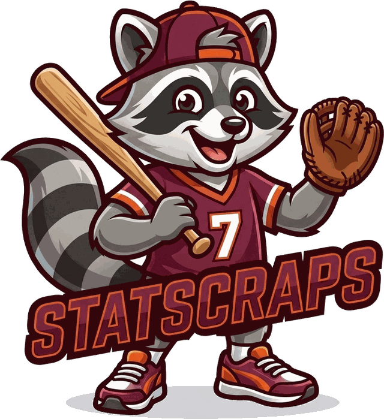
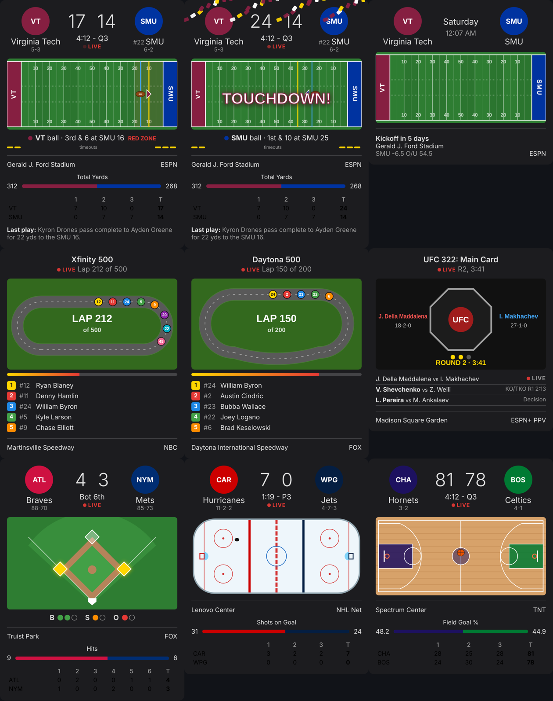

<p align="center"></p>

# Stat Scraps

**Stat Scraps with Scrappy**: your one stop for college football news,
scores and stats, plus other sports. Scrappy, the raccoon in the backwards
cap, is the site's mascot and resident college football guru.

A single self-hosted Docker container that shows college football schedules,
live scores/stats, and a "Notable Games" section you curate week-by-week
from an admin page. Virginia Tech (or whichever team you configure) is
always pinned at the top.

- **Data**: ESPN's public college football API by default, with automatic
  fallback to your own [ncaa-api](https://github.com/henrygd/ncaa-api)
  instance (`https://ncaawidget.example.net`) if ESPN is unreachable.
- **Storage**: a small SQLite file (just the notable-games picks) persisted
  to a mounted volume — everything else is fetched live.
- **Admin**: a single shared password (set via env var) protects `/admin`,
  where you pick which games are "notable" for the current week.
- **Pages**: Schedule & Scores, Notable Games, and News live as tabs on the
  home page (Schedule/Notable share the same card style, so notable games
  show channel/time/ranking just like the full schedule). Separate pages
  cover Rankings (poll picker covering every poll ESPN returns — AP, AFCA
  Coaches, FCS Coaches, Division II/III, etc. — plus others receiving
  votes) and Conference Standings. Clicking any team name anywhere opens
  that team's own page (season schedule + season stats). Clicking a game
  card opens that game's own dedicated page — live/final score, leaders,
  box score, and latest drive — never season-long stats for either team.

> **Note on Rankings/Standings**: these two came from ESPN's less-documented
> endpoints. The parsing is written from the well-known shape of that data,
> but ESPN doesn't publish an official schema, so if a field looks off once
> you're on live data, it's usually a one-line fix in `src/espn.js`
> (`getRankings` / `getStandings`) to point at the right field name.

### Rankings, standings, team pages, player pages and fantasy

- **Rankings**: pick any past week (or the final poll), see each team's
  movement and last-week rank, who's new, who dropped out, and the week's
  biggest rise and drop. A **Compare polls** view puts the CFP, AP and
  Coaches rankings side by side.
- **Standings**: home and away records, points for and against, point
  differential, and AP rank badges for ranked college teams.
- **Team pages**: record splits (home, away, conference), scoring averages
  and recent form, then tabs for Schedule & Results, a searchable
  **Roster** (with injury tags), Season Stats and team News.
- **Player pages** (`/player.html?id=...`): bio, this season's game log
  and season-by-season stats. Every roster and leaders entry links here.
- **Leaders** (`/leaders.html`): season stat leaders for every team sport.
  For the NFL a **Fantasy** tab adds up each week's box scores into
  PPR, half-PPR or standard points, filterable by QB, RB and WR/TE.
- New API routes (all take `?sport=`): `/api/team/:id/roster`,
  `/api/player/:id`, `/api/leaders`, `/api/fantasy?week=&format=ppr|half|standard`.
  The code is in `src/players.js`, `src/leaders.js` and `src/routes/stats.js`.

### Betting lines and recruiting

- **Lines** (`/lines.html`): every game's spread, total and moneylines for
  the week (or day, for daily sports), with each price, how the line moved
  since it opened, and once a game is final, who covered and whether the
  total went over. A week summary shows favorites against the spread and
  overs/unders. Filter to ranked games or the teams you follow. Lines come
  from ESPN's feed, so lower-profile games may have none.
- **Recruiting** (`/recruiting.html`, college football): portal and
  recruiting news from Google News plus matching stories from the News
  feeds. The **Transfer Portal**, **Top Recruits** and **Class Rankings**
  tabs use CollegeFootballData.com and need a free API key in
  `CFBD_API_KEY` (get one at https://collegefootballdata.com/key). Without
  a key those tabs explain how to add one. Rows for teams you follow are
  highlighted, and each tab can be filtered to them.

### Also in this version

- The `/admin` page is no longer linked from the site nav — it's still live
  at `/admin`, just not advertised, so bookmark it.
- Finished games now always show an explicit **W** / **L** chip next to
  each team, not just a bolded name, so a final score is unambiguous at a
  glance (this also fixed a bug where the team-schedule page showed
  "Final" with no score at all for some games — ESPN's per-team schedule
  feed shapes scores differently than the main scoreboard feed does).
- An **FBS / FCS** toggle now appears on Schedule & Scores, Rankings, and
  Standings. FCS rankings in particular are best-effort — ESPN's public
  API has thin FCS poll coverage, so that page may say "not available"
  depending on the week; schedules/scores/standings work for FCS either way.
- The color scheme is no longer maroon-and-orange everywhere. Site chrome
  (header, tabs, buttons) now uses a neutral blue accent; the "this is my
  team" cues (favorite card border, favorite badge, is-favorite highlight)
  use a distinct neutral gold so they read as "your team," not as a
  specific team's colors. Individual team pages now pull that team's own
  real color from ESPN for their header stripe, so Miami's page looks like
  Miami and Virginia Tech's still looks like Virginia Tech.
- The header got a small wordmark treatment (icon + gradient title). Now
  using your own logo — see "Latest round of changes" below.
- New: **`GET /api/notable/feed`** — your notable-game picks, grouped by
  week and pre-joined with live score/status/broadcast/venue, meant for
  pulling into an external dashboard (see below).

### Latest round of changes (new logo)

- **New logo**: the penguin mascot is replaced by the "Uprights" mark (a
  football between goalposts) in Turf Green `#17703C`, used for the header
  icon on every page, the favicon (SVG + 32px PNG) and the touch icon. A
  white horizontal lockup is in `public/img/cfbtracker-horizontal-white.svg`
  if you want it elsewhere. Same filenames as before, so nothing else changed.

### Latest round of changes (live field position diagram)

- **The individual game page now shows where the ball actually is.** When
  a game is live, a yard-line field diagram appears under the scorebug
  with the ball drawn at the current spot, a dashed yellow first-down
  marker, each team's color/logo in their own end zone, a small arrow
  showing which direction the offense is driving, a "RED ZONE" badge when
  applicable, and each team's remaining timeouts. It's built from ESPN's
  live `situation` data (down/distance/yardLine/possession), which isn't
  officially documented — **this is the one piece of this feature that's
  unverified against a real live game**: it assumes `yardLine` is 0-100
  measured from the possessing team's own goal line (so 35 = their own
  35-yard line, 65 = midfield-and-35-yards-further). If you ever watch a
  live game and the ball shows up on the wrong side of the field from
  where the broadcast has it, that assumption is the first thing to check
  — see the comments next to `parseSituation` in `src/espn.js` and
  `computeFieldData` in `public/js/game.js`. The diagram only appears for
  live games with usable situation data; it's hidden for games that
  haven't started or have finished.

### Previous round of changes (fixed news images for real, YouTube video feed)

- **News images, properly fixed this time.** The previous fix (checking
  `content:encoded` as well as `description`) was correct but wasn't
  enough on its own — it can only find an image if the RSS feed embeds
  one somewhere, and apparently your ESPN feed (via the rss.example.net
  bridge) just doesn't carry one at all, while Fox Sports' only carries a
  small icon-sized thumbnail that then got stretched into a blurry 16:9
  card. The real fix: for every article, the app now fetches the article
  page itself (just enough of it to read `<head>`, not the whole page)
  and pulls its `og:image` meta tag — the same "featured image" every
  article publishes for link previews on social media. That's almost
  always present and full-resolution, so it now replaces the feed's own
  image (or fills in when there wasn't one) for every source. Results are
  cached per-article for 24 hours, so this cost is paid once per story,
  not on every page load. If you'd rather skip this (fewer outbound
  requests, faster refresh, back to feed-only images) set
  `NEWS_FETCH_OG_IMAGES=0`.
- **New Videos tab**, next to News, pulling recent uploads from the 7
  YouTube channels in your Dynacat config (Hokie Sports, Joel Klatt Show,
  247Sports, Josh Pate's CFB Show, ACC Digital Network, ESPN College
  Football, On3) via YouTube's public per-channel feed — no API key or
  quota needed. Click a thumbnail to play the video right there in the
  card (an embedded player swaps in) instead of leaving the site. Change
  the channel list anytime with `YOUTUBE_CHANNELS_JSON` (see the env
  table below) without touching code.

### Previous round of changes (Upcoming as its own page, news image fix)

- **"Upcoming This Week" moved off the home page** into its own page
  (`/upcoming.html`, linked in the nav next to Rankings/Standings) with
  its own season/week/type/FBS-FCS controls — it was cramped as a home
  page widget. Each game there now also shows its broadcast channel next
  to the kickoff time, so a full week's slate is easy to scan by network.
- **Fixed ESPN images not showing in the News tab.** Two bugs: the image
  lookup checked the `description` field OR `content:encoded`, but with
  `||` — so if `description` existed at all (even with no image in it),
  `content:encoded` never got checked, which is exactly the shape ESPN's
  feed apparently comes through this bridge in. Now both are checked
  independently, plus a last-resort scan for any bare image URL in the
  item, in case a namespaced tag (`media:thumbnail`, etc.) got stripped
  somewhere along the way. Fox Sports/CBS Sports were unaffected since
  their images apparently came through a tag this already handled.

### Branding: Stat Scraps with Scrappy

- The app is now called **Stat Scraps**, with Scrappy the raccoon as its
  mascot. His head is the header icon, favicon and installed-app icon; the
  full logo is in `public/img/scrappy-logo.png`.
- The default **Classic** theme uses Scrappy's maroon and orange
  (`public/css/brand.css`). The other sports themes keep their own colors.
- Container name, image (`ghcr.io/spacegoose02/sports-tracker`), app data
  folder (`/mnt/user/appdata/cfb-tracker`) and database file are unchanged,
  so existing installs update in place.

### Previous round of changes (logo, play-by-play, odds, possession, calendar, richer news)

- **Logo & branding**: the site now uses your `cfbtracker.png` mascot as
  its icon/wordmark everywhere (browser tab favicon, every page header,
  Dynacat left as-is since that's a separate config). The app is now
  branded "CFB Tracker" consistently instead of the old full "College
  Football Tracker" name.
- **Play-by-play**: a game's page now has a full Play-by-Play feed (not
  just the last few plays of the current drive) — every play from every
  drive so far, newest first, with scoring plays highlighted. This only
  shows once a game has actually started; ESPN's `drives` data is empty
  pregame.
- **Over/Under & spread**: every game card (schedule, notable games) shows
  a compact odds line when ESPN has a line for that game, and the game
  page has a dedicated Odds section. This is best-effort — ESPN doesn't
  publish odds for every game (mostly just current-week FBS matchups with
  a real sportsbook line), so plenty of games simply won't show one.
- **Possession indicator**: a small football icon now appears next to
  whichever team currently has the ball on live game cards and the game
  page's scorebug, using ESPN's live "situation" data.
- **Upcoming This Week**: a new calendar-style strip on the home page,
  grouped by day, showing every not-yet-played game for the week you're
  viewing — click one to jump straight to its game page.
- **News tab redesign**: cards now show a thumbnail image when the RSS
  feed provides one (tries `media:content`, `enclosure`, and an ``
  inside the article description, in that order), laid out like an
  actual news section instead of a plain link list. Feeds without an
  image get a plain placeholder card instead of a broken image.
- **Removed "data via ESPN / ncaa-api" text** from the footer and page
  subtitles across the site, per your request — the app still falls back
  to ncaa-api the same as before, it just doesn't advertise which source
  answered a given request anymore.

### Previous round of changes

- **Games now open their own page** (`/game.html?id=...`) instead of a
  popup modal — clicking a game card always takes you to that game's
  score/leaders/box score/latest drive, and clicking a team name inside a
  card (or on the game page itself) always takes you to that team's own
  schedule + season stats page. The link is shareable/bookmarkable now,
  and it fixed a rough edge where the two click targets (game vs. team)
  could feel like they were fighting each other in the old popup.
- **Rankings page**: removed the separate FBS/FCS toggle. It turned out
  redundant — ESPN's rankings endpoint already returns every poll it has
  (AP Top 25, AFCA Coaches, FCS Coaches Poll, AFCA Division II/III
  Coaches) in one response, and the existing Poll dropdown already lets
  you pick among them. Schedule & Scores and Standings still have their
  FBS/FCS toggle since those really are separate ESPN queries.
- **New News tab** on the home page, pulling headlines from your
  configured RSS feeds (ESPN, Fox Sports, and CBS Sports college football
  feeds by default) and merging them newest-first. See
  `NEWS_FEEDS_JSON` below if you ever need to change which feeds it pulls
  from.

## Home page

`/` is an all-sports front page: your followed teams from every sport
first (live score, next game or last result), a **Live now** row with the
closest live games across every league, a card per league that's in season
with its top games and live / upcoming / final counts, and mixed headlines.
Leagues with no games this week are listed as off-season. It all comes from
one call, `GET /api/home?teams=cfb:259,nba:25` (`src/home.js`), and
refreshes every 30 seconds while anything is live.

Each sport's full scoreboard (Schedule & Scores, Notable Games, News,
Videos) is now at `/scores?sport=...`; `/index.html` still works too.

## Other sports

A sport picker at the top of every page switches between **College
Football** (the default), **NFL**, **NBA**, **men's college basketball**,
**MLB**, **NHL**, **WNBA**, the **Premier League**, **MLS** and the
**Champions League**, plus **UFC**, **NASCAR**, **Formula 1** and the **PGA
Tour**. Every page and API route takes `?sport=` (`cfb`, `nfl`, `nba`,
`mcbb`, `mlb`, `nhl`, `wnba`, `epl`, `mls`, `ucl`, `ufc`, `nascar`, `f1`,
`golf`), so links are shareable, and the last sport you
picked is remembered in your browser. Leaving `sport` off means college
football, so existing bookmarks and the Dynacat widget keep working.

- Football (CFB, NFL) pages through weeks; the others page through days,
  and Upcoming shows the next seven days.
- Rankings only appear for leagues with polls (CFB and college hoops).
- Standings show the columns each league uses (conference record for
  college, win % and games back for the NBA/MLB, points for the NHL).
- The live field diagram is football-only; live baseball games show the
  count, outs and runners instead.
- News for other sports comes from ESPN's league headlines. College
  football keeps your RSS feeds and the Videos tab.
- The pinned favorite team (`FAVORITE_TEAM_ID`) and Notable Games stay
  college-football features.
- **Soccer** (`epl`, `mls`, `ucl`) works like the other team sports. Draws
  are normal, league tables are sorted by points with games played and
  goals for, against and difference, and kids get soccer explanations,
  trivia and a goal horn.
- **Formula 1** (`f1`) lists race weekends like NASCAR, and the **PGA
  Tour** (`golf`) lists tournaments with the top of the leaderboard and
  each player's score to par.
- **UFC** (`ufc`) and **NASCAR Cup Series** (`nascar`) list events instead
  of games: each UFC card shows every fight (main event first, winner and
  method once it's over), and each NASCAR race shows the top 10 of the
  running order. The home page covers the last 30 days and the next 60;
  Upcoming shows the next 60. They have no team pages, follows or standings.
- To add a league ESPN covers, add one entry to `src/sports.js`.

## Following teams

Anyone using the site can follow as many teams as they like, in any sport:
open a team's page and tap **☆ Follow**. Follows are saved in that
visitor's browser, so every person (and device) has their own list.

- **My Teams** at the top of the home page shows each followed team in
  the current sport with its record and live or next game. Tap × to
  unfollow.
- Games involving a followed team are highlighted and listed first on
  Schedule & Scores; followed teams are also highlighted in Rankings and
  Standings.
- The **News** tab defaults to **My teams**: ESPN headlines for the teams
  you follow, each tagged with its team (`GET /api/news/teams?sport=cfb&teams=259,52`,
  up to 10 teams). **All news** shows the full feed as before.
- `FAVORITE_TEAM_ID` is still used as a starting point: a visitor's first
  visit follows that team automatically, and unfollowing it sticks.

## Accounts, game alerts and calendar

Following teams works without an account. Signing in (top-right link on
every page, or `/account.html`) adds:

- **Your teams on every device.** Followed teams are stored on the
  account. The first time you sign in on a device, the teams you followed
  there are added to your account; after that every device shows the same
  list. Signing out clears the list from that device, so the next person
  to sign in there starts fresh.
- **Game alerts.** Tap **Turn on alerts on this device** to get a
  notification when a team you follow kicks off and a final score when the
  game ends. Each device opts in on its own, and each kind of alert can be
  switched off. Alerts use the browser's own web push, so they need the
  site on **HTTPS**; on iPhone, add the site to the Home Screen and open it
  from there first. The server checks scores once a minute
  (`GAME_ALERTS=false` turns the checker off).
- **More alerts, all off until you turn them on:** every score by a team
  you follow ("TOUCHDOWN! Hokies", "GOAL! Arsenal"; not basketball, which
  scores too often), **close games** late in any game of a sport you
  follow a team in (a one-score game in the last quarter, half or period),
  and **upsets brewing** (a ranked team losing in the second half).
- **Calendar.** **Add to calendar** subscribes your phone's calendar to a
  private feed of every game for every team you follow
  (`/calendar/<key>.ics`). New games and kickoff changes update on their
  own. Without an account, the account page still offers a feed for the
  teams followed in that browser (`/calendar.ics?teams=cfb:259,nba:2`).

### Signing in

There are two ways, and they can be used together:

- **Email and password.** On by default. Set `ALLOW_SIGNUP=false` to stop
  new sign-ups (existing accounts and SSO keep working).
- **Single sign-on with Tinyauth** (or any OpenID Connect provider:
  Authentik, Authelia, Pocket ID, Keycloak...). Add a client to Tinyauth:

  ```
  TINYAUTH_OIDC_CLIENTS_tracker_CLIENTID=cfb-tracker
  TINYAUTH_OIDC_CLIENTS_tracker_CLIENTSECRET=<a long random string>
  TINYAUTH_OIDC_CLIENTS_tracker_TRUSTEDREDIRECTURIS=https://sports.example.com/auth/sso/callback
  TINYAUTH_OIDC_CLIENTS_tracker_NAME=Stat Scraps
  TINYAUTH_OIDC_CLIENTS_tracker_TRUSTED=true
  ```

  and give the tracker the matching values:

  ```
  PUBLIC_URL=https://sports.example.com
  SSO_ISSUER=https://auth.example.com
  SSO_CLIENT_ID=cfb-tracker
  SSO_CLIENT_SECRET=<the same secret>
  ```

  A **Sign in with Tinyauth** button then appears on the account page. If
  the SSO account's email matches an existing email/password account,
  the two are joined, so a person has one account whichever way they sign
  in. Don't put the whole site behind Tinyauth's forward auth: the public
  pages should stay public, and sign-in happens through this button.

`SESSION_SECRET` must be set to a real value for accounts: with a random
one, everyone is signed out on every restart. Sign-ins last 30 days.

### Your teams in other apps (Den Duty)

The account page shows a private key under **Connect other apps**. Another
app sends it to read that person's followed teams and their games:

```
GET /api/account/teams
Authorization: Bearer <key>
```

```json
{
  "user": { "displayName": "Sam" },
  "teams": [{
    "sport": "cfb", "sportLabel": "College Football",
    "id": "259", "name": "Virginia Tech Hokies", "abbreviation": "VT",
    "logo": "https://...", "color": "#630031", "record": "6-3", "rank": null,
    "url": "https://sports.example.com/team.html?id=259&source=espn&sport=cfb",
    "liveGame": null,
    "nextGame": { "id": "401...", "date": "2026-11-07T20:00Z", "status": { "state": "pre" }, "home": {...}, "away": {...}, "broadcast": "ACC Network" },
    "lastGame": { ... },
    "upcoming": [ ... next 3 games ... ]
  }]
}
```

The response also carries `recap`: Scrappy's latest morning recap (see
below), or `null`.

Games have the same shape as `/api/scoreboard` games. The key is read
only. **Make a new key** on the account page revokes the old one (and
changes the calendar link). Signed in on the site itself, the same
endpoint works with the session cookie and no key.

### Scrappy's morning recap

On the account page, **Scrappy's morning recap** sends a short summary of
your teams every morning at a time you pick: last night's results, anything
live, the next game this week with kickoff time (in your time zone) and TV,
and a headline when it matters. It's off until you turn it on, and each
account picks its own time; the time zone comes from your browser when you
turn it on or change the time.

- It arrives as a notification on every device with alerts on. On days when
  none of your teams has a result or a game this week, it's saved but
  doesn't buzz you. **Send me one now** writes one on the spot (6 an hour).
- With `ANTHROPIC_API_KEY` set, Scrappy (Claude) writes it from the live
  data, with no tools and nothing from memory. Without a key, or if the call
  fails, a plain recap is built from the same facts.
- The latest recap is saved, so other apps can read it with the private key:

```
GET /api/account/recap
Authorization: Bearer <key>
```

```json
{
  "user": { "displayName": "Sam" },
  "enabled": true, "time": "07:30", "timeZone": "America/New_York",
  "recap": {
    "date": "2026-11-02",
    "headline": "Hokies hold off FSU 31-24",
    "text": "Big night in Blacksburg! ...",
    "source": "scrappy",
    "createdAt": "2026-11-02T12:30:04Z",
    "teams": [{ "sport": "cfb", "id": "259", "name": "Virginia Tech Hokies", "record": "7-2", "rank": 22,
                "result": { "opponent": "Florida State", "teamScore": 31, "opponentScore": 24, "outcome": "W", ... },
                "live": null,
                "next": { "opponent": "Miami", "when": "Sat, Nov 7 3:30 PM", "tv": "ACC Network", ... } }]
  }
}
```

Den Duty gets the same `recap` in `/api/account/teams`. Home Assistant has
a recap sensor; see [the Home Assistant guide](docs/home-assistant.md#scrappys-daily-recap).
The schedule checks once a minute (`DAILY_RECAP=false` turns it off). If
the server is down at someone's time, their recap still goes out when it
comes back, up to three hours late; after that, that day is skipped.

## Installing on your phone

Stat Scraps is a Progressive Web App, so you can add it to your home screen and open it like a normal app:

- **iPhone (Safari):** tap Share, then **Add to Home Screen**.
- **Android (Chrome):** tap the menu, then **Install app** (or accept the install banner).

Once installed it opens full screen, keeps the header pinned while you scroll, and remembers pages you've visited, so the last scores and rankings you loaded still show on a bad connection. When you're fully offline, pages you haven't opened yet show a friendly "You're offline" screen.

Install and offline support need the site to be served over **HTTPS** (or opened on `localhost`). On a plain `http://192.168.x.x` LAN address the site still works, but phones won't offer to install it. Put it behind your reverse proxy with a certificate (Nginx Proxy Manager, Traefik, a Cloudflare tunnel...) to get the full app experience.

The service worker lives in `public/sw.js`. If you change how it caches, bump its `VERSION` so every phone drops the old cache on its next visit.

## Español and accessibility

The **Aa** button in the header opens the Display panel:

- **Language / Idioma**: English or Español. Spanish is picked automatically when the browser's language is Spanish, and `?lang=es` or `?lang=en` on any link sets it. Scrappy answers in Spanish too.
- **Motion**: follow the device, Reduce (no confetti, pulsing live dots or other animations) or Full.
- **Contrast**: follow the device, Standard, or High (stronger muted text and borders, underlined links).

Under the hood, `public/js/i18n.js` translates the rendered page from a dictionary of the English UI text (`public/js/i18n-es.js`), so page scripts keep writing English and nothing else has to change. To translate new UI text, add the exact English string and its Spanish version to that file; anything missing simply shows in English. Team names, headlines and Scrappy's replies are never run through the dictionary.

`public/js/a11y.js` and `public/css/a11y.css` add a skip link, a visible focus ring, keyboard access (Enter or Space) for clickable game cards, lines and videos, `aria-pressed` on tab buttons, and a polite screen reader announcement when the score changes on a game page. Every theme's text, link and badge colors pass WCAG AA contrast in both light and dark mode.

## Kids Zone

Things for kids watching with the family. Signed out, players, picks and stickers are saved in the browser. Signed in, they're saved to the account (see [Family leagues](#family-leagues) below), so they follow you to every phone and tablet.

- **Kid mode** (the 🧒 button in the header): bigger logos and scores, simpler status words ("Playing now!", "Game over"), no betting odds, and on a game's page a "What just happened?" box that explains the last play in plain words ("That's a touchdown, worth 6 points!").
- **Celebrations**: when a team you follow scores, the Scores page and the game page throw confetti in the team's color, show a big banner and play a "Charge!" fanfare (a goal horn for hockey). Basketball only celebrates wins, since it scores every few seconds. Turn confetti or sounds off on the Kids page. To play a real fight song instead, put an mp3 at `public/sounds/<sport>-<team id>.mp3`, for example `public/sounds/cfb-259.mp3`.
- **Pick'em** (`/kids.html`): add each player, then everyone picks winners for this week's games until kickoff. Right picks count on a family leaderboard and earn badges (first win, 3 in a row, 10 and 25 right, perfect week, upset spotter).
- **Trivia**: ten questions mixing the teams you follow (nickname, logo, home stadium, team color) with rules questions for those sports.
- **Sticker book**: a team sticker for every live game you watch on its game page and every pick you get right.
- **Countdown** (`/countdown.html`): a big countdown to the next game of every team you follow. "Full screen" (or `?kiosk=1`) hides the header for a TV or tablet.

For other code, such as a Home Assistant hook, every celebration also fires a `tracker:score` event on `window`:

```js
window.addEventListener('tracker:score', (e) => {
  // e.detail: { kind: 'score' | 'win', sport, gameId, teamId, teamName,
  //             color, points, label, score, opponent: { id, name, score } }
});
```

The saved data goes through `Kids.store` (see `public/js/kids.js`). Listen for `tracker:kids-data` to know when something changed, and wait for `Kids.ready` before reading saved data on page load.

### Game day games (the Play tab)

Every game page has a **Play** tab (the first tab in kid mode):

- **Game Day Bingo**: a 4x4 card of things like Touchdown, Interception,
  Punt and Penalty flag (goals, cards and corners for soccer; dunks and
  steals for basketball...). Squares fill in by themselves from the
  play-by-play. Four in a row is a BINGO (30 XP), the whole card 100. Each
  player gets their own card for each game.
- **Call it!** During a live game, guess the next play (run, pass or kick,
  football) for 10 XP, and who scores next for 25 XP.
- **Guess the final score** before kickoff. An exact score is worth 50 XP,
  close guesses less, plus 10 for the right winner. The guess also saves
  as that player's pick'em pick, and the family league leaderboard counts
  who had the closest guess in each game.
- **Trading cards**: a game's stars (top passer, rusher, scorer...) become
  collectible cards once the game ends, for a player who watched it live
  on its game page or picked the winner. Big games make rare, epic and
  legendary cards. Tap a card to flip it. The **Cards** tab on the Kids
  page is the binder.
- **League XP**: signed in and in a family league, the tab shows everyone's
  XP for this game.

### Levels, streaks and Scrappy's closet

Picks, bingo, play calls, score guesses, trivia, cards and coming back
every day all earn **XP**. The **Level up** tab on the Kids page shows each
player's level, their daily streak (10 XP a day, 50 more every 7th day in a
row), their latest XP, and the league's XP this week. New levels unlock
outfits for Scrappy (a foam finger, team scarf, cool shades, coach headset,
crown...) that show up next to the player's name.

### Watch party chat

The game page's **Chat** tab is a chat for your family league during the
game, with quick emoji reactions. Post as yourself or as one of your Kids
Zone players. Messages are plain text, members only, 20 a minute, and the
newest 300 per game are kept.

### Read it out loud

In kid mode, **Read my scores** in the header has Scrappy say how your
teams are doing (live score, last result or next game), and the "What just
happened?" box on a game page has a **Read it to me** button. It uses the
browser's own voice, so nothing is sent anywhere.

## Playoffs and brackets

`/brackets.html` (the 🏆 Playoffs link in the header) is the postseason hub:

- **College Football Playoff**: the 12-team bracket by round, with seeds, scores, TV and bowl sites. Before the field is set it shows a projection from the latest CFP rankings (or the AP poll before those come out), seeded straight down. The real field also saves spots for the highest-ranked conference champions, so the page labels it "if the season ended today".
- **Bowls**: every bowl game, grouped by day.
- **March Madness**: the men's tournament by region (Round of 64 to Elite Eight), the First Four, and the Final Four. Before Selection Sunday it shows last year's bracket.
- The arrows switch seasons. Pages use ESPN's postseason scoreboard (`GET /api/brackets?sport=cfb|mcbb&season=`); finished seasons are cached for a day.

**Family bracket challenge**: each Kids Zone player picks the winner of each game before it starts. As matchups are set round by round, picks open for the next round. Bowls are worth 1 point; CFP rounds are 1, 2, 4 and 8; tournament rounds are 1 (First Four and Round of 64), 2, 4, 8, 16 and 32.

## Family leagues

Signing in saves Kids Zone players, pick'em picks, stickers and bracket picks to the account. Whatever a browser saved before signing in is merged into the account once, then cleared from that browser. Settings (confetti, sound) and "who's playing" stay per device. Pages stay public; signing in is only for saving.

A family league is a group of accounts. Start one on the Kids Zone's Pick'em tab, then share the invite code or link (`/kids.html?join=CODE`). Every player on every member's account shows up on:

- the **weekly pick'em leaderboard** on the Kids Zone, for the sport on screen (football by week; daily sports roll up Monday to Sunday), with a menu for past weeks, and
- the **bracket challenge standings** on the playoff hub.

League standings are worked out on the server from ESPN's final scores, and only count picks saved to the account before kickoff, so nobody can pick after the fact. A pick made while signed out counts in the league once it's saved to the account before the game starts. The league owner can make a new code (the old one stops working) and remove members; when the owner leaves, the longest-standing member takes over.

API (signed in): `GET /api/family/data`, `POST /api/family/data/merge`, `PUT /api/family/data/:key`, `GET|POST /api/family/leagues`, `POST /api/family/leagues/join`, `GET /api/family/leagues/:id/leaderboard?sport=&week=`, `GET /api/family/leagues/:id/bracket?sport=&season=`, `GET /api/family/leagues/:id/xp?since=&game=`, `GET|POST /api/family/leagues/:id/chat?game=&after=`. Saved keys are `players`, `picks`, `stickers`, `brackets`, `xp` and `cards`. See `src/routes/family.js`.

## TV wall mode

`/wall.html` (the **TV Wall** link on the home page) is a full-screen scoreboard for a TV or a tablet on the wall. It rotates through live games first, then games about to start and fresh finals, with your followed teams always ahead of the rest. Football games show the live field with the ball, first-down line and red zone (the same drawing as the Home Assistant card), baseball shows the diamond and count, and everything else shows the score by period. When a live game's score changes, the wall jumps to it with a "Score!" banner.

- Options in the URL: `?sports=cfb,nfl` (default: every sport you follow a team in), `?every=15` (seconds per game, 5 to 120, default 12) and `?mine=1` (only your teams' games).
- Keys: Left and Right step through games, Space pauses, F goes full screen. The controls and cursor hide after a few seconds.
- The page asks the browser to keep the screen awake while it's open.

## Multiview

`/multiview.html` (in the More menu) shows two or four games at once, each
drawn like the TV wall (live field, diamond or score by period). It fills
itself with the best live games, your teams first, or tap **Choose games**.
The picks are kept in the link (`?games=cfb:401,nfl:9&n=4`), so a
bookmark opens the same games. F goes full screen.

## Award races

`/awards.html` (Heisman watch for college football, MVP race for the NFL)
ranks players for the Heisman, Davey O'Brien, Doak Walker, Biletnikoff and
Nagurski awards, and the NFL MVP and offensive and defensive player of the
year. Nobody publishes these as data, so it's Stat Scraps' own projection
from ESPN's season stat leaders: a points formula per award, plus a bonus
for a ranked team (college) or a winning record (NFL). A snapshot is saved
each week, so arrows show who moved up or down. `GET /api/awards?sport=cfb`.

## Advanced college football stats

With `CFBD_API_KEY` set (the same free key as the recruiting tabs), a
college team's **Season Stats** tab adds SP+ (overall, offense, defense)
and offense and defense EPA per play, success rate, explosiveness and havoc
rate, each with its national rank, and a game's **Box Score** tab adds an
advanced box score for both teams. `GET /api/team/:id/advanced?sport=cfb`
and `GET /api/game/:id/advanced?sport=cfb`; without a key they answer
`{ "available": false, "reason": "no-key" }`.

## Highlights

A finished game's page shows highlight clips above the box score: ESPN's own clips (they play right on the page) plus uploads from the Videos tab's YouTube channels whose title names both teams. Clips often show up an hour or two after the final, so an open page checks again every 10 minutes until some arrive.

## Ask Scrappy (AI chat)

Scrappy is the site's raccoon mascot and sports guru, living in a chat bubble in the bottom corner of every page. Ask him things like "When do the Hokies play next and what channel?", "Who's in the AP Top 10?", "What do the ACC standings look like?" or "Who leads the NFL in passing yards?" and he answers from the same live data the site shows: scores, schedules, TV and radio, rankings, standings, team and player stats, stat leaders and news, for every sport on the site.

- **Turn it on** by setting `ANTHROPIC_API_KEY` (create one at [console.anthropic.com](https://console.anthropic.com/)), or point him at an Ollama server with `OLLAMA_URL` (below). With neither set the bubble doesn't appear at all.
- **Ollama instead of Claude**: set `OLLAMA_URL` to your Ollama server (for example `http://192.168.1.10:11434`) and `OLLAMA_MODEL` to a model that supports tool calling (default `qwen3`; `llama3.1`, `qwen2.5` and `gpt-oss` also work). To use Ollama's cloud models, set `OLLAMA_URL=https://ollama.com` plus `OLLAMA_API_KEY` from [ollama.com/settings/keys](https://ollama.com/settings/keys). If both a Claude key and `OLLAMA_URL` are set, Claude is used unless `SCRAPPY_PROVIDER=ollama`. Local models can be slow on a cold start; `OLLAMA_TIMEOUT_SECONDS` (default 120) sets how long to wait.
- **Web search** (optional, works with Claude or Ollama): set `OLLAMA_API_KEY` to use Ollama's web search API, or `SEARXNG_URL` to use your own [SearXNG](https://docs.searxng.org/) instance (enable the `json` format in its `settings.yml`). Scrappy then gets a `web_search` tool for sports questions the site's data doesn't cover, like coaching news or history, and still uses the live site data first for scores, schedules and stats.
- **Cost control**: each visitor (by IP) gets 8 messages a minute and 100 a day by default (`SCRAPPY_RATE_PER_MINUTE`, `SCRAPPY_RATE_PER_DAY`). Behind a reverse proxy, set `TRUST_PROXY` so the limit sees real visitor IPs. You can also set a monthly spend limit on the Anthropic console.
- **Model**: Claude Opus 5.5 at low effort by default; set `SCRAPPY_MODEL` to use another Claude model (for example `claude-sonnet-5-5` or `claude-haiku-5-5` to spend less).
- **Kid-safe**: Scrappy keeps it family-friendly, sticks to sports, and won't give betting advice. Replies are shown as plain text, never as HTML.
- The conversation stays in the browser tab (sessionStorage) and is only sent to the server when you ask a question. Nothing is saved on the server.

The server side is `src/scrappy.js` (the prompt and tools) and `src/routes/scrappy.js`; the bubble is `public/js/scrappy.js` and `public/css/scrappy.css`.

## Dashboards (Dynacat / Glance)

Every signed-in account has a private, read-only feed key (Account page,
"Connect other apps"). Send it as `Authorization: Bearer <key>` and these
return JSON a Glance/Dynacat `custom-api` widget can render:

- `/api/account/dashboard`: teams, notable games and Scrappy's recap in one call
- `/api/account/notable/feed?weeks=3`: your notable games with live scores
- `/api/account/teams`: your followed teams with live, next and last game
- `/api/account/recap`: Scrappy's latest daily recap

Ready-to-paste widgets: `dynacat-notable-games-widget.yaml` and
`dynacat-my-teams-widget.yaml`. Full field list and setup:
[docs/dashboards.md](docs/dashboards.md).

## Home Assistant scorecards

`custom_components/sports_tracker` is a Home Assistant integration (HACS
custom repository: this repo) that turns the teams you follow into sensors
and ships a dashboard card with a live football field, NASCAR track outline,
baseball diamond, hockey rink, basketball court and UFC octagon, plus score
events for automations like flashing the lights on a touchdown. See
[docs/home-assistant.md](docs/home-assistant.md).



## Running with Docker

A ready-made image is published to GitHub Container Registry on every push
to `main`:

```
ghcr.io/spacegoose02/sports-tracker:latest
```

It runs on amd64 and arm64, keeps everything it needs to save (the SQLite
database with accounts, follows and notable games, plus the push-alert keys)
in `/app/data`, and has a built-in health check (`GET /healthz`) so Docker and
Unraid show it as healthy or unhealthy. Set `PUID`/`PGID` to choose which user
owns the files in the data folder (Unraid's default is `99`/`100`).

At minimum, set `ADMIN_PASSWORD` and `SESSION_SECRET` (a long random string,
for example the output of `openssl rand -hex 32`). Every other setting is
listed in [`.env.example`](.env.example).

### Unraid: Docker tab template (recommended)

1. Download the template onto your server from the Unraid terminal:

   ```bash
   wget -O /boot/config/plugins/dockerMan/templates-user/my-cfb-tracker.xml \
     https://raw.githubusercontent.com/Spacegoose02/sports-tracker/main/unraid/cfb-tracker.xml
   ```

2. In the **Docker** tab, click **Add Container** and pick **cfb-tracker**
   from the **Template** dropdown.
3. Fill in **Admin password** and **Session secret**. Change the favorite
   team or add a CFBD API key if you like; the rest is under
   **Show more settings**. App data defaults to
   `/mnt/user/appdata/cfb-tracker`.
4. Click **Apply**, then open the WebUI from the container's icon.

Updates show up in the Docker tab like any other container ("update ready"),
and your data in appdata survives them.

### Unraid: Docker Compose Manager, Portainer or plain Compose

[`docker-compose.yml`](docker-compose.yml) uses the published image and lists
every setting, most of them commented out. Change `ADMIN_PASSWORD` and
`SESSION_SECRET`, then `docker compose up -d` (or **Compose Up** in the
Compose Manager plugin). To build from source instead, swap `image:` for
`build: .` in that file.

### Plain `docker run`

```bash
docker run -d \
  --name cfb-tracker \
  --restart unless-stopped \
  -p 3000:3000 \
  -e PUID=99 -e PGID=100 \
  -e ADMIN_PASSWORD="something-private" \
  -e SESSION_SECRET="$(openssl rand -hex 32)" \
  -e FAVORITE_TEAM_ID="259" \
  -e FAVORITE_TEAM_NAME="Virginia Tech Hokies" \
  -v /mnt/user/appdata/cfb-tracker:/app/data \
  ghcr.io/spacegoose02/sports-tracker:latest
```

### Behind a reverse proxy

When the site sits behind Nginx Proxy Manager, SWAG, Traefik or a Cloudflare
tunnel, set `TRUST_PROXY=1` and `PUBLIC_URL` to the public address. Point
uptime monitors at `/healthz`.

### Updating

Pull the new image and recreate the container: Unraid's **Update** button,
`docker compose pull && docker compose up -d`, or `docker pull` then re-run.
Your data in `/mnt/user/appdata/cfb-tracker` is kept.

### Publishing the image and cutting releases

`.github/workflows/docker.yml` builds the image on every pull request and
pushes `latest` (plus a short commit tag) from `main`.

To cut a release, open **Actions**, pick **Release**, click **Run workflow**
and enter a version such as `1.1.0`. It runs the tests, publishes
`ghcr.io/spacegoose02/sports-tracker:1.1.0` (and `1.1`, `latest`), tags
`v1.1.0` and creates the GitHub release. Release notes come from
`docs/releases/v1.1.0.md` if you write one, otherwise GitHub lists the merged
pull requests. Pushing a `v*` tag yourself also publishes versioned images.

The first time an image is published, open the package on GitHub (your
profile, **Packages**, **sports-tracker**, **Package settings**) and set its
visibility to **Public** so Unraid can pull it without logging in.

## Sharing ESPN data with BingeBandit (the ESPN relay)

Other apps on your network can read ESPN through this tracker, so ESPN is
asked once and everyone shares the cached answer. BingeBandit's Sports
section uses this.

1. Set `RELAY_API_KEY` to a long random string (for example the output of
   `openssl rand -hex 24`) and restart the container. The relay stays off
   while it's unset.
2. In BingeBandit, open **Server → Settings → Sports data**, enter this
   tracker's address (e.g. `http://192.168.1.10:3000`) and the same key.

`GET /espn/site/v2/sports/{sport}/{league}/{endpoint}` with header
`X-Api-Key: <key>` answers what ESPN's
`https://site.api.espn.com/apis/site/v2/sports/...` would, for any league.
Only the read endpoints apps need are relayed: `scoreboard`, `teams`,
`teams/{id}`, `teams/{id}/schedule`, `summary`, `rankings` and `news`.
Answers are kept 15 seconds while a game in them is live or about to
start, 5 to 10 minutes otherwise, and 12 hours for team lists. If ESPN
fails, the last copy (up to a day old) is served with `X-Cache: STALE`.
If the tracker is down, BingeBandit reads ESPN directly until it's back.

### Watch on BingeBandit

The game page's **Where to watch** box can link straight to the BingeBandit
Live TV channel that shows the game ("Watch on BingeBandit · Channel 206 ·
for ESPN2"). It uses the same pairing as the relay, in the other direction:

1. Pair the apps as above (`RELAY_API_KEY` here, the same key in
   BingeBandit's **Sports data** settings).
2. Set `BINGEBANDIT_URL` to BingeBandit's address (e.g.
   `http://192.168.1.10:8484`) and restart.

For each of a game's TV networks, BingeBandit picks the channel an admin tied
to it under **Admin → Live TV → Networks**, or else a channel named for it
("US: ESPN 2 HD" for ESPN2). Networks with no channel get no link, and the
link isn't shown once the game is over. The tracker only learns channel
names and numbers; opening the link still needs a BingeBandit sign-in.
Answers are cached for 5 minutes, and if BingeBandit is down the links just
don't appear.

**Not seeing the button?** Open `/admin` and look at **Watch on
BingeBandit**. It checks each step in order and names the first one that's
missing: `BINGEBANDIT_URL` unset, no key, BingeBandit unreachable, BingeBandit
older than v0.43.0, no Sports data key in BingeBandit, keys that don't match,
or no channel for the main sports networks. When it works, it lists which
networks link to which channel.

If browsers should open BingeBandit at a different address than this server
uses to reach it (say, its public URL), set `BINGEBANDIT_LINK_URL`. To use a
different key than the relay's, set `BINGEBANDIT_API_KEY` and put that key in
BingeBandit's Sports data settings instead.

## Configuration (environment variables)

| Variable | Default | Purpose |
|---|---|---|
| `PORT` | `3000` | Port the app listens on inside the container |
| `ADMIN_PASSWORD` | `changeme` | Password for `/admin` — **change this** |
| `SESSION_SECRET` | *(placeholder)* | Cookie signing secret — **change this** |
| `FAVORITE_TEAM_ID` | `259` | ESPN team ID pinned at the top (259 = Virginia Tech) |
| `FAVORITE_TEAM_NAME` | `Virginia Tech Hokies` | Display name for the pinned team |
| `NCAA_API_BASE` | *(unset: fallback off)* | Your ncaa-api instance, used as a fallback if ESPN is down |
| `NCAA_API_DIVISION` | `fbs` | Division for ncaa-api fallback scoreboard calls |
| `CACHE_TTL_SECONDS` | `20` | How long scoreboard responses are cached in memory |
| `NEWS_FEEDS_JSON` | *(public ESPN / CBS Sports / Yahoo Sports CFB feeds)* | Optional JSON array of `{"name":"...","url":"..."}` to override the News tab's RSS feeds entirely |
| `NEWS_FETCH_OG_IMAGES` | `1` (on) | Set to `0` to stop fetching each article's `og:image` for the News tab — faster/fewer outbound requests, but back to whatever (if anything) the RSS feed itself embedded |
| `YOUTUBE_CHANNELS_JSON` | *(your 7 Dynacat channels)* | Optional JSON array of `{"id":"UC...","name":"..."}` to override the Videos tab's channel list entirely |
| `RELAY_API_KEY` | *(unset: relay off)* | Turns on the ESPN relay at `/espn/...` for BingeBandit and other apps; they send it as `X-Api-Key` |
| `BINGEBANDIT_URL` | *(unset: off)* | BingeBandit's address, e.g. `http://192.168.1.10:8484`. Adds **Watch on BingeBandit** channel links to game pages (see [Watch on BingeBandit](#watch-on-bingebandit)) |
| `BINGEBANDIT_LINK_URL` | *(`BINGEBANDIT_URL`)* | Address browsers open the links at, when it differs (e.g. BingeBandit's public URL) |
| `BINGEBANDIT_API_KEY` | *(`RELAY_API_KEY`)* | Key sent to BingeBandit; must match its **Sports data** key |
| `TRUST_PROXY` | *(unset)* | Set to `1` when the app sits behind a reverse proxy so the admin login rate limit sees each visitor's real IP |
| `PUBLIC_URL` | *(from the request)* | The site's public address, e.g. `https://sports.example.com`. Used for the SSO callback and calendar links; set it when behind a reverse proxy |
| `ALLOW_SIGNUP` | `true` | Set to `false` to stop new email/password sign-ups |
| `SSO_ISSUER` | *(unset: SSO off)* | Your Tinyauth (or other OpenID provider) address, e.g. `https://auth.example.com` |
| `SSO_CLIENT_ID` / `SSO_CLIENT_SECRET` | *(unset)* | The OIDC client configured in Tinyauth |
| `SSO_LABEL` | `Tinyauth` | Button text: "Sign in with ..." |
| `VAPID_PUBLIC_KEY` / `VAPID_PRIVATE_KEY` | *(generated)* | Web push keys. Left unset, a pair is generated once and saved as `vapid.json` in the data folder |
| `VAPID_SUBJECT` | `mailto:admin@localhost` | Contact address push services see; use your email |
| `GAME_ALERTS` | *(on)* | Set to `false` to stop checking scores for game alerts |
| `ANTHROPIC_API_KEY` | *(unset: Scrappy off)* | Turns on Scrappy, the AI sports chat bubble (see [Ask Scrappy](#ask-scrappy-ai-chat)) |
| `SCRAPPY_MODEL` | `claude-opus-5-5` | Claude model Scrappy uses |
| `OLLAMA_URL` | *(unset)* | Runs Scrappy on an Ollama server instead of Claude, e.g. `http://192.168.1.10:11434` or `https://ollama.com` |
| `OLLAMA_MODEL` | `qwen3` | Ollama model Scrappy uses; it must support tool calling |
| `OLLAMA_API_KEY` | *(unset)* | Ollama account key: needed for `https://ollama.com`, and turns on Scrappy's web search |
| `SEARXNG_URL` | *(unset)* | Your SearXNG instance, for Scrappy's web search without an Ollama key |
| `SCRAPPY_PROVIDER` | *(auto)* | `anthropic` or `ollama`, when both are configured |
| `OLLAMA_TIMEOUT_SECONDS` | `120` | How long to wait for an Ollama reply |
| `SCRAPPY_RATE_PER_MINUTE` / `SCRAPPY_RATE_PER_DAY` | `8` / `100` | Scrappy messages allowed per visitor IP |
| `DAILY_RECAP` | *(on)* | Set to `false` to stop sending Scrappy's morning recaps |
| `RECAP_NOW_PER_HOUR` | `6` | "Send me one now" recaps allowed per IP per hour |

To find a different team's ESPN ID, visit
`https://site.api.espn.com/apis/site/v2/sports/football/college-football/teams`
and search for the team, or check the URL on ESPN's team page
(`espn.com/college-football/team/_/id/<ID>/...`).

## How it works

- **Home page (`/`)** — pick a season/week/season-type, see the full
  scoreboard with your favorite team pinned first, a "Notable Games"
  section, and click any game card for live box score / leaders / latest
  drive. Signed in, Notable Games is your own list: tap the star on any
  game card to add or remove it. Signed out, it shows the admin's picks.
- **Admin page (`/admin`)** — log in with `ADMIN_PASSWORD`, pick a week,
  and toggle which games are the site's default "notable" picks (what
  signed-out visitors see; users can copy them into their account).
  Notes/labels are optional (e.g. "ACC opener", "Top 10 matchup").
- **Radio and TV (`/admin`)** — fix the TV channel or radio stations when
  ESPN is wrong or missing. Save a change for one game (TV channels,
  national radio, an extra watch link, a note) or for a team in any sport
  (radio flagship and extra stations, city, free audio link, and a usual
  TV channel used only when ESPN lists none). Changes are stored in the
  SQLite file in `DATA_DIR`, show up right away on scoreboards, team
  schedules and game pages, and win over ESPN's data. Save a blank form or
  press Remove to go back to ESPN's info.
- Live games auto-refresh every 20 seconds while any game in the current
  view is in progress.
- If ESPN's API errors out, the app automatically retries the same request
  against your ncaa-api instance and tags the response so you know which
  source served it (shown in the small text under the page title).

## Security

- **Set real secrets.** When `NODE_ENV=production` (the Docker image sets
  it), `/admin` stays locked until `ADMIN_PASSWORD` is something other than
  the placeholder. A missing or placeholder `SESSION_SECRET` is replaced
  with a random one at startup, which works but logs everyone out of
  `/admin` on every restart. The server log says exactly what to change.
- **Admin login is rate limited** to 10 attempts per 15 minutes per IP.
- **Outside content is escaped.** News headlines, video titles, ESPN data
  and admin notes are all escaped before they reach the page, and only
  `http(s)` links and images are allowed through.
- **Keep private feed URLs out of the code.** Put RSS-bridge URLs with
  tokens in `NEWS_FEEDS_JSON` in your `.env` or container settings.

## Tests

```bash
npm test
```

The Home Assistant integration has its own Python tests
(`tests/home_assistant`, see [docs/home-assistant.md](docs/home-assistant.md)).
Both run on every pull request through GitHub Actions.

## Local development (without Docker)

```bash
npm install
cp .env.example .env   # edit ADMIN_PASSWORD / SESSION_SECRET
npm start
```

Then open `http://localhost:3000`.
