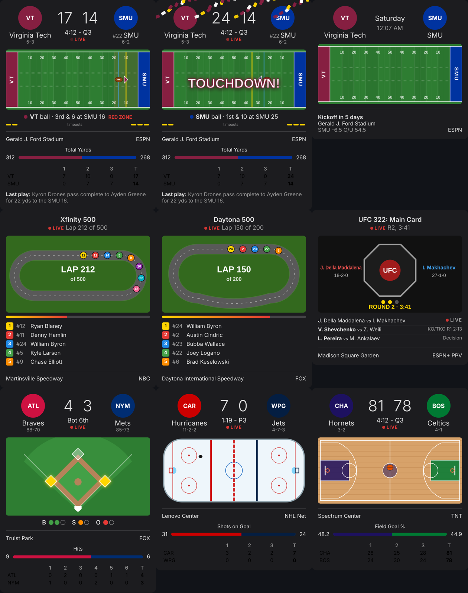

# Home Assistant scorecards

Live scorecards for the teams you follow, on your Home Assistant dashboards,
fed by your own Sports Tracker. Every sport gets its own picture:

- **Football** (college and NFL): the field in both teams' colors, the ball
  sliding to its new spot after each play, the yellow first-down line, a
  flashing red zone, down & distance and timeouts.
- **NASCAR**: an outline of the track (Martinsville's paperclip, Pocono's
  triangle, Daytona's tri-oval, short tracks, road courses), the top ten cars
  circling it, the lap counter and a race progress bar.
- **Baseball**: the diamond with runners lit up, plus balls, strikes and outs.
- **Hockey**: the rink with a sliding puck and shots on goal.
- **Basketball**: the court in team colors with a bouncing ball and FG%.
- **UFC**: the octagon with the fight happening now, the round and clock, and
  results from the rest of the card.

When your team scores, the card throws confetti in team colors with
"TOUCHDOWN!", "FIELD GOAL!", "GOAL!" or "RUN SCORES!".



The integration and the card come together: installing the integration also
loads the card on every dashboard, so there's no separate resource to add.

## Install

### With HACS

1. HACS → three-dot menu → **Custom repositories**.
2. Repository: `https://github.com/Spacegoose02/sports-tracker`, type
   **Integration**.
3. Download **Sports Tracker**, then restart Home Assistant.

### By hand

Copy `custom_components/sports_tracker` from this repo into your Home
Assistant `config/custom_components/` folder and restart.

## Set up

1. **Settings → Devices & services → Add integration → Sports Tracker.**
2. Enter your tracker's address, the same one you open in a browser, for
   example `http://192.168.1.50:3000`. Home Assistant needs to be able to
   reach it.
3. On the integration, press **Configure** to follow things:
   - **Follow a team**: pick the sport, then type to search for the team.
   - **Follow UFC or NASCAR**: always shows the current or next fight night
     or race.
   - **Stop following**.

Each follow becomes a sensor such as
`sensor.sports_tracker_virginia_tech_hokies` or
`sensor.sports_tracker_nascar_cup_series`.

## Add the card

Edit a dashboard → **Add card** → search for **Sports Tracker**, or in YAML:

```yaml
type: custom:sports-tracker-card
entity: sensor.sports_tracker_virginia_tech_hokies
```

| Option      | Default | What it does                                          |
|-------------|---------|-------------------------------------------------------|
| `entity`    |         | A Sports Tracker sensor (required)                    |
| `visual`    | `true`  | The field, track, diamond, rink, court or octagon     |
| `linescore` | `true`  | Score by quarter, period or inning                    |
| `last_play` | `true`  | The last play, while the game is live                 |
| `celebrate` | `true`  | Confetti when your team scores                        |

To show only teams that are playing today, wrap cards in a conditional card
on the sensor's state (`IN`, or `PRE`).

## The sensors

State is `PRE` (scheduled), `IN` (live), `POST` (final) or `NOT_FOUND` (no
games on the schedule). Attributes you can use in templates and automations:

`team_name`, `team_abbr`, `team_score`, `team_record`, `team_rank`,
`opponent_name`, `opponent_abbr`, `opponent_score`, `date`, `venue`, `tv`,
`status`, `clock`, `period`, `last_play`, plus the full scorecard the card
draws (`team`, `opponent`, `event`, `field`, `bases`, `stat`, `race`, `card`,
`odds`, `next_game`).

Home Assistant checks every 15 seconds while a game is live, every minute in
the hour before a game, and every 30 minutes on quiet days.

## Automations

Two events fire on Home Assistant's event bus:

- `sports_tracker_score` when either team scores. Data: `scored_by` (`team`
  or `opponent`), `points`, `scoring_team`, `scoring_team_color`, `team`,
  `team_score`, `opponent`, `opponent_score`, `sport`, `event_name`.
- `sports_tracker_game_state` when a game starts or ends. Data:
  `from_state`, `to_state`, plus the teams and scores.

Flash the living room lights in team colors when your team scores:

```yaml
alias: Touchdown lights
triggers:
  - trigger: event
    event_type: sports_tracker_score
    event_data:
      item: "cfb:259"        # the sport:team id you follow
      scored_by: team
actions:
  - repeat:
      count: 4
      sequence:
        - action: light.turn_on
          target: { entity_id: light.living_room }
          data:
            rgb_color: [134, 31, 65]   # Virginia Tech maroon
            brightness: 255
        - delay: 0.6
        - action: light.turn_on
          target: { entity_id: light.living_room }
          data: { rgb_color: [232, 119, 34] }  # burnt orange
        - delay: 0.6
```

Announce the final score:

```yaml
alias: Final score
triggers:
  - trigger: event
    event_type: sports_tracker_game_state
    event_data: { to_state: POST }
actions:
  - action: notify.notify
    data:
      message: >
        Final: {{ trigger.event.data.team }} {{ trigger.event.data.team_score }},
        {{ trigger.event.data.opponent }} {{ trigger.event.data.opponent_score }}
```

## Tracker endpoints it uses

The integration only talks to your tracker, never to ESPN directly, so the
tracker's cache keeps ESPN requests down no matter how many dashboards are
open.

- `GET /api/ha/scorecards?items=cfb:259,nhl:7,nascar,ufc` — up to 20
  scorecards in one request, keyed by item.
- `GET /api/ha/scorecard?sport=cfb&team=259` — one scorecard.
- `GET /api/teams?sport=cfb` — every team in a league, for the team picker.

## Development

```bash
python3 -m venv .venv && .venv/bin/pip install -r tests/home_assistant/requirements.txt
.venv/bin/pytest
```
